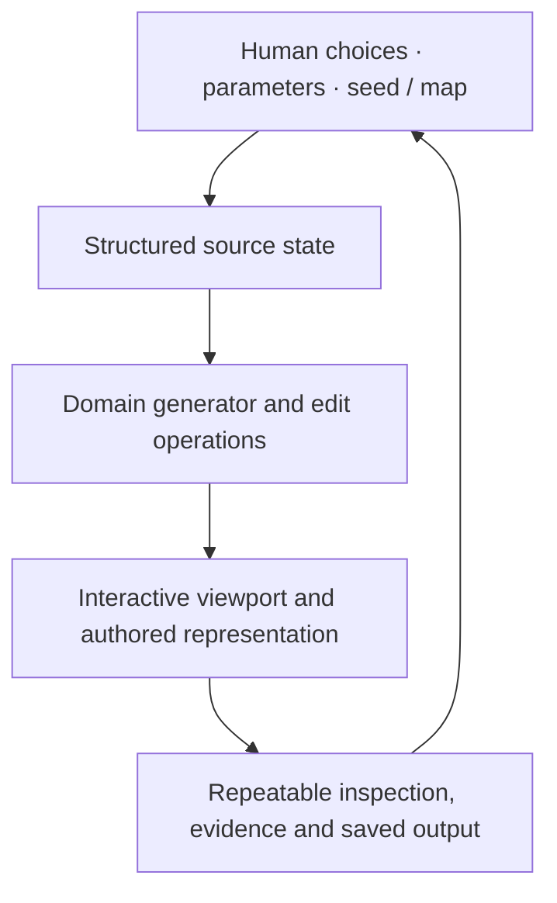

# CLOUD UNPACKER PRO · WEATHER STUDIO

### Weather should be authored as structured fields, not a collection of painted clouds.

**Procedural authoring · parameterized scenes · repeatable source-driven observation**

The difference between an editable procedural world and an attractive one-off render is **source control**: an artist or engineer should be able to change a generating parameter, understand why the scene changed, and reproduce it later.

**CLOUD UNPACKER PRO · WEATHER STUDIO** explores a specialized part of that direction. The source includes an interactive weather-map canvas and tools for cloud types, pressure systems and weather fronts, a texture manager, map presets, a split editor, preview/render components, a flight HUD and a jet scene. `WeatherEditorPage.tsx` also includes save/load and JSON import/export paths. These are concrete app modules, not proof that the resulting maps are meteorologically calibrated or accepted in a full planet-scale cloud renderer.

> **Qualification boundary:** this README is based on checked-in source modules. No new browser render, physics validation, actual integration with external simulation engines or target GPU benchmark was performed when changing this document.

**Source navigation:** [WeatherEditorPage.tsx](src/pages/WeatherEditorPage.tsx) · [WeatherMapCanvas.tsx](src/components/WeatherMapCanvas.tsx) · [CloudPreview3D.tsx](src/components/CloudPreview3D.tsx) · [SplitWeatherEditor.tsx](src/components/SplitWeatherEditor.tsx)

---

## One source state, several observations



| Domain | Current source area |
|---|---|
| **Model/data authority** | Editable params, seed or weather-map data structures |
| **Authoring interface** | Browser controls and specialized tool panels |
| **Scene visualization** | Programmatic preview and renderer components |
| **Persistence and reproducibility** | Must be tested for every exposed save/export path |
| **Scientific accuracy** | No claim of field calibration from a visual preview |

## Getting started

```bash
npm install
npm run dev
# npm run build
```

These are the Vite application's declared development/build paths, not newly verified executions. Use the local URL returned by the development server.

## Verification targets

Run real browser interactions: create front/pressure features, edit and save maps, reload JSON, compare the weather-field texture before/after serialization, and verify that preview and fly-through read the same weather state. Test all linked cloud renderers independently of meteorological truth.

## Relation to the simulation ecosystem

This interface could become an authoring surface for Nimbus and the broader weather stack once provider contracts, units, scale, time and actual visual parity are demonstrated. No such integration is automatically implied by this UI source.

**A useful procedural studio preserves the reason a scene exists—not just the pixels that depict it.**

---

*Replaces the generated starter README with source-specific engineering context; no application code changed.*
